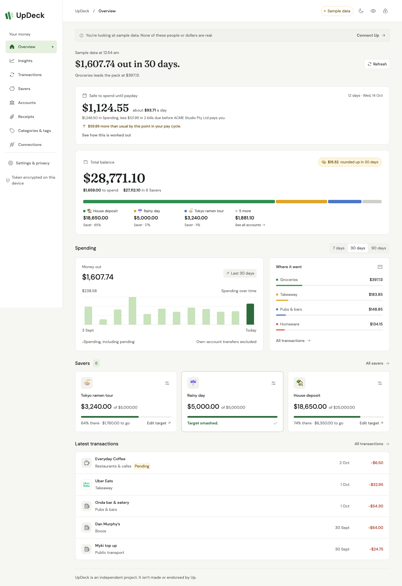

# UpDeck

An unofficial dashboard for [Up](https://up.com.au/) customers. It puts your balances, spending, Savers and Round-Ups in a full browser tab, and works out things the Up app doesn't: what's safe to spend until payday, which subscriptions you're paying for, and what changed this month.

I built it with React, TypeScript and Cloudflare's [Kumo](https://kumo-ui.com/) components, on top of the [Up API](https://developer.up.com.au/). It isn't made or endorsed by Up, and it can't move money.



## What it does

**Insights**, all worked out in your browser:

- **Safe to spend until payday.** Finds your regular pay, takes out the bills due before it, and shows what's left per day. It also says whether this pay cycle is running ahead of or behind your usual.
- **Subscriptions & bills.** Anything charged on a steady weekly, fortnightly, monthly or quarterly rhythm, with its yearly cost. Price rises are flagged, and so are subscriptions that seem to have stopped.
- **What changed.** The last 30 days against the months before, in sentences like "Takeaway +$145.30, mostly Uber Eats on Fridays."
- **2Up split.** Who spent what from a joint account.
- **Tax time & tags.** Tag totals for the Australian financial year, plus a CSV export.

**Everything else:**

- Overview with total balance, a breakdown by account, Round-Ups and spending by category
- Full transaction history with search and filters. Each transaction opens as its own page, with Round-Up, card, foreign amount, note and receipt
- Category and tag changes, each reviewed before it's sent to Up
- Savers with your own targets (kept for the session only; they don't change your goals in Up)
- Accounts, receipts, categories and tags, and Up webhooks with delivery logs
- Real merchant logos bundled with the extension, light and dark mode, and a one-click button to hide amounts

Transfers between your own accounts don't count as spending. Pending purchases do; pending income doesn't count until it settles.

## Try it

```sh
npm ci
npm run dev
```

The web preview only has sample data. It can't connect to Up and never shows a token field.

## Install the extension

```sh
npm run build
```

| Browser                  | Install                                                                                                                                                                                                         |
| ------------------------ | --------------------------------------------------------------------------------------------------------------------------------------------------------------------------------------------------------------- |
| Chrome 120+, Edge, Brave | Open the extensions page, turn on developer mode, choose **Load unpacked** and pick `dist/chrome`.                                                                                                              |
| Firefox 142+             | Open `about:debugging#/runtime/this-firefox`, choose **Load Temporary Add-on** and pick `dist/firefox/manifest.json`. It stays installed until Firefox restarts.                                                |
| Safari                   | Needs a Safari Web Extension app wrapper and Xcode signing, which I haven't done. See [Apple's packaging guide](https://developer.apple.com/documentation/safariservices/packaging-a-web-extension-for-safari). |

Click the toolbar icon to open UpDeck in a tab. After rebuilding, reload the extension from the extensions page, or the browser keeps running the old background script.

## Connect your Up account

1. Create a personal access token in the Up app's **Data sharing** settings, or at [api.up.com.au](https://api.up.com.au/).
2. Open UpDeck. The first screen is the connect form.
3. Paste the token and choose a passphrase of at least 14 characters. UpDeck checks the token with Up, then encrypts it on your device.
4. Next time, unlock with the passphrase. UpDeck locks after five minutes, when you switch away from the tab, or when the browser suspends the extension.

Up's API is for personal use, so only ever use your own token, and don't paste it into code, screenshots or chats. If you forget the passphrase, choose **Forgot your passphrase?** on the unlock screen to remove the saved token, then connect again. To cancel a token completely, revoke it in Up.

## How I test it

```sh
npm run check           # unit tests, type check and production builds
npm run test:e2e        # browser tests with sample data, including accessibility checks in light and dark mode
npx playwright install chromium
npm run test:extension  # the packaged extension against a mocked Up API
```

The extension test drives the real background script against a mock of Up's API and checks the exact requests it sends, including category and tag changes and the financial-year report. Set `UPDECK_CHROMIUM_EXECUTABLE` to use an existing Chrome for Testing. [docs/VERIFICATION.md](docs/VERIFICATION.md) has the latest results, [docs/API-COVERAGE.md](docs/API-COVERAGE.md) maps every Up endpoint to the screen that uses it, and [SECURITY.md](SECURITY.md) explains the security model.

## Project layout

```text
src/background.ts        Session, lock and the only code that talks to Up
src/security/vault.ts    AES-GCM token encryption
src/security/up-api.ts   Up API client with an endpoint allowlist
src/insights.ts          Pay, subscriptions, comparisons, tag totals and CSV, all on-device
src/domain.ts            Schemas and money calculations
src/App.tsx              App shell, lock screen, Overview and Savers
src/components/          Insights, transactions, accounts, receipts, webhooks and charts
scripts/                 Builds, store images and release packaging
tests/                   Unit, browser and packaged-extension tests
```

Fonts, scripts, icons and styles all ship inside the extension. Merchant logos come from [Simple Icons](https://simpleicons.org/) (CC0); the trademarks belong to their owners. Merchants without a logo get an icon for their Up category.

## Publishing

```sh
npm run release
```

This runs the tests and build, then writes `release/` with the Chrome and Firefox packages, a source archive for Mozilla's reviewers, store screenshots and tiles, and the listing text in `LISTING.md` and `REVIEWER-NOTES.md`.

## Licence

[MIT](LICENSE) © 2026 Bakari Mustafa. UpDeck isn't made, endorsed or reviewed by Up or Bendigo and Adelaide Bank.
